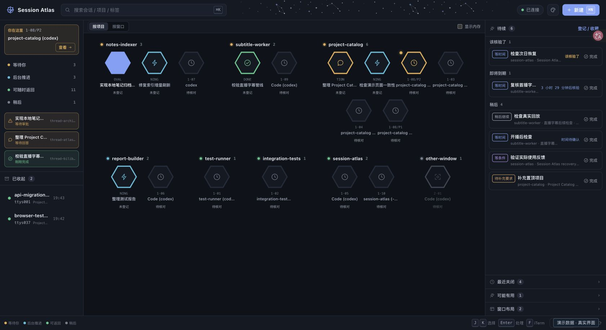

# Session Atlas · Codex Session Map

[中文](README.md)｜English

Bring your parallel Codex sessions in iTerm2 onto one local map. Find threads waiting for your response, save unfinished work, and return to the original thread and directory after closing a window.

[User guide](docs/usage.md) · [Versions and verification](docs/compatibility-and-distribution.md) · [Feedback](https://github.com/peipei-labs/session-atlas/issues)



## Preview the interface

With Node.js 22.12+, run:

```sh
git clone https://github.com/peipei-labs/session-atlas.git
cd session-atlas
npm ci
VITE_SESSION_ATLAS_DEMO=1 npx vite --host 127.0.0.1 --port 4318
```

Open <http://127.0.0.1:4318>. The demo uses fixed data and does not connect to real sessions.

## Connect your terminal

Requires macOS, iTerm2 3.6+ with its Python API enabled, Python 3, and a Codex CLI that passes the automatic protocol check. Installation checks the protocol structure and initialization handshake; see [compatibility notes](docs/compatibility-and-distribution.md) for verification limits.

```sh
npm run install:macos
```

Open <http://127.0.0.1:4317>. Browser send, answer, and interrupt actions work only with Atlas-managed Codex threads. The service runs locally and saves short handoff notes and recovery metadata, without storing full conversations.

[Installation, shortcuts, and uninstall](docs/usage.md#macos-installation) · [Handoffs and recovery](docs/session-continuation.md) · [Known issues](docs/known-issues.md)

[MIT](LICENSE) · [Third-party notices](THIRD_PARTY_NOTICES.md)

Community: [LINUX DO](https://linux.do/)
